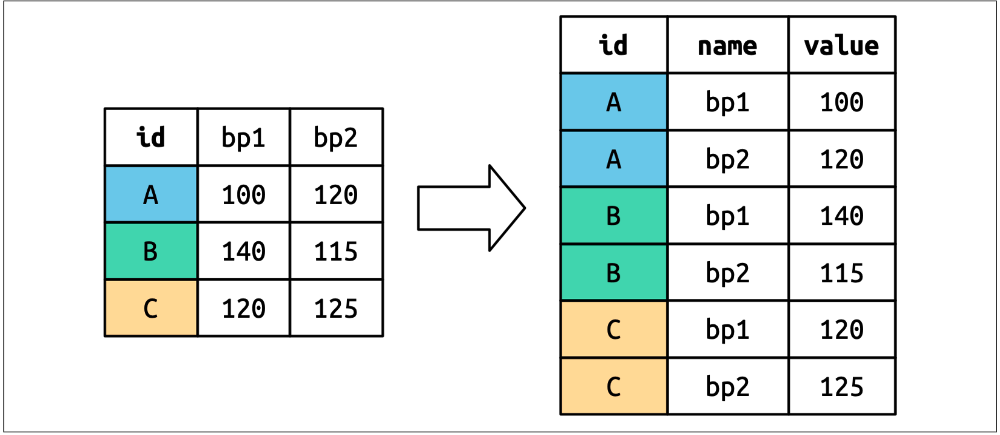

```{r}
#| echo: false
setwd("~/Documents/Cursos/Laboratorio")
```

# Objetivo general

## Objetivo

Llevar a cabo pruebas de hipótesis y estimación por intervalo con R base y tidyverse, usando los datos de fisiología del ejercicio.

# Lectura de los datos.

## Directorio de trababjo

-   Verificamos cuál es el directorio actual.

```{r}
#| echo: true
#| output-location: fragment
#| column: screen-inset-shaded 
getwd()
```

-   Fijamos el directorio de trabajo.

```{r}
#| echo: true
#| output-location: fragment
#| column: screen-inset-shaded 
setwd("~/Documents/Cursos/Laboratorio")
```

## Cargamos tidyverse

```{r}
#| echo: true
#| output-location: fragment
#| column: screen-inset-shaded 
library(tidyverse) 
options(pillar.sigfig = 5) 
```

## Lectura de los datos

```{r}
#| echo: true
#| output-location: fragment
#| column: screen-inset-shaded

library(readxl) #<1> 
df <- read.csv("DatosFisioLimpio.csv",row.names=1, stringsAsFactors=TRUE)
```

## Verificación de lectura.

### `summary`

```{r}
#| echo: true
#| output-location: fragment
#| column: screen-inset-shaded
summary(df)   
```

## Verificación de lectura.

### `glimpse`

```{r}
#| echo: true
#| output-location: fragment
#| column: screen-inset-shaded
glimpse(df)
```

## Pregunta a responder

::: callout-important
Hipótesis: La fuerza prensil promedio de la mano derecha es mayor en hombres que en mujeres.
:::

## Visualización previa

```{r}
#| echo: true 
library(tidyverse)
library(broom)
df |> 
  ggplot(aes(x = sexo, y = fuerza_md, fill = sexo)) +
  geom_boxplot() +
  labs(title = "Dispersión de fuerza de mano derecha por Sexo")
```

## Conclusiones

Se sospecha que:

-   Hay diferencia en los promedios, dado que en el boxplot la caja de los hombres está mas arriba.

-   Las varianzas son distintas, lo cual se evidencia porque la caja de los hombres es más larga que la de las mujeres.

## Estadísticas por `sexo`

Calculemos ahora la media, la varianza y el error estándar de la media, desagregado por sexo.

```{r}
#| echo: true
#| output-location: fragment
#| column: screen-inset-shaded

df|>group_by(sexo)|>summarise(N=n(),Media=mean(fuerza_md),Var=var(fuerza_md))  
```

## Error estándar de la media

Si no tenemos una función en el paquete base, la escribimos

```{r}
#| echo: true
#| output-location: fragment
#| column: screen-inset-shaded
eemedia=function(x){
  sd(x,na.rm = TRUE)/sqrt(length(na.omit(x))) 
}
```

```{r}
#| echo: true
#| output-location: fragment
#| column: screen-inset-shaded

df|>group_by(sexo)|>summarise(N=n(),Media=mean(fuerza_md),Var=var(fuerza_md),Ee=eemedia(fuerza_md))  
```


## Error estándar de la media II 

Sin usar la función 


```{r}
#| echo: true
#| output-location: fragment
#| column: screen-inset-shaded

df|>group_by(sexo)|>summarise(N=n(),Media=mean(fuerza_md),Sd=sd(fuerza_md)) |> mutate(ee=Sd/sqrt(N))   
```


# Hipótesis sobre igualdad de varianzas. 


## Prueba de igualdad de varianzas

::: callout-warning
Antes de probar la hipótesis con respecto a la media, debemos probar si se cumple el supuesto de varianzas iguales.
:::

Probaremos la hipótesis $$H_0:\sigma^2_m=\sigma^2_f$$ con una prueba $F$, implementada en la función `var.test`.

## Uso de `var.test`


```{r}
#| echo: true
#| output-location: fragment
#| column: screen-inset-shaded

df |>with(var.test(fuerza_md~sexo)) 
```


```{r}
#| echo: true
#| output-location: fragment
#| column: screen-inset-shaded

resultados_f <- df |>with(var.test(fuerza_md~sexo))|>tidy()
```

```{r}
#| echo: true
#| output-location: fragment
#| column: screen-inset-shaded
print(resultados_f ) 
```

# Hipótesis sobre igualdad de medias, varianzas distintas 

## Prueba de la hipótesis

Prueba T de Welch `Var.equal = FALSE` por defecto en R

Probaremos la hipótesis 
$$H_0: \mu_m=\mu_f \\
H_1: \mu_m>\mu_f$$

## Prueba de la hipótesis 

```{r}
#| echo: true
#| output-location: fragment
#| column: screen-inset-shaded

df |>with(t.test(fuerza_md~sexo,alternative='greater'))
```


## Prueba de la hipótesis, alternativa correcta 

```{r}
#| echo: true
#| output-location: fragment
#| column: screen-inset-shaded

df |>with(t.test(fuerza_md~sexo,alternative='less')) 
```


## Guardando resultados como tabla 

```{r}
#| echo: true
#| output-location: fragment
#| column: screen-inset-shaded

resultados_t <- df |>with(t.test(fuerza_md~sexo,alternative='greater'))|>tidy()
print(resultados_t)
```


## ¿Qué se concluye?

::: callout-caution
No se rechaza la hipótesis nula porque el valor p es mayor que 0.05 
:::

## Ojo 

::: callout-warning
La conclusión anterior no es correcta, porque la diferencia de media se está calculando al revés  
:::


# Nivel de referencia de un factor. 


## Nivel de referencia 

```{r}
#| echo: true
#| output-location: fragment
#| column: screen-inset-shaded
df$sexo=factor(df$sexo)
levels(df$sexo) 
```


```{r}
#| echo: true
#| output-location: fragment
#| column: screen-inset-shaded

df$sexo=relevel(df$sexo,ref="Masculino") 
levels(df$sexo) 
```


## Repetimos la prueba 

```{r}
#| echo: true
#| output-location: fragment
#| column: screen-inset-shaded

df |>with(t.test(fuerza_md~sexo,alternative='greater'))

```


## Repetimos la prueba (guardar) 

```{r}
#| echo: true
#| output-location: fragment
#| column: screen-inset-shaded

resultados_t <- df |>with(t.test(fuerza_md~sexo,alternative='greater'))|>tidy()
print(resultados_t)
```


# Hipótesis sobre la diferencia de medias, varianzas iguales.   


## Pregunta a responder

::: callout-important
Hipótesis: La masa muscular promedio es mayor en hombres que en mujeres.
:::

## Visualización previa

```{r}
#| echo: true 
df |> 
  ggplot(aes(x = sexo, y = masa_muscular, fill = sexo)) +
  geom_boxplot() +
  labs(title = "Dispersión de Masa Muscular por Sexo")
```

## Conclusiones

Se sospecha que:

-   Hay diferencia en los promedios, dado que en el boxplot la caja de los hombres está mas arriba.

-   Las varianzas prodrían ser  distintas, lo cual se evidencia porque la caja de los hombres es más larga que la de las mujeres.

-   hay que hacer la prueba de hipótesis formal. 

## Estadísticas por `sexo`

Calculemos ahora la media, la varianza y el error estándar de la media, desagregado por sexo.

```{r}
#| echo: true
#| output-location: fragment
#| column: screen-inset-shaded

df|>group_by(sexo)|>summarise(N=n(),Media=mean(masa_muscular),Var=var(masa_muscular))  
```

## Error estándar de la media

Si no tenemos una función en el paquete base, la escribimos

```{r}
#| echo: true
#| output-location: fragment
#| column: screen-inset-shaded
eemedia=function(x){
  sd(x,na.rm = TRUE)/length(na.omit(x)) 
}
```

```{r}
#| echo: true
#| output-location: fragment
#| column: screen-inset-shaded

df|>group_by(sexo)|>summarise(N=n(),Media=mean(masa_muscular),Var=var(masa_muscular),Ee=eemedia(masa_muscular))  
```

## Prueba de igualdad de varianzas

::: callout-warning
Antes de probar la hipótesis con respecto a la media, debemos probar si se cumple el supuesto de varianzas iguales.
:::

Probaremos la hipótesis $$H_0:\sigma^2_m=\sigma^2_f$$ con una prueba $F$, implementada en la función `var.test`.

## Uso de `var.test`

```{r}
#| echo: true
#| output-location: fragment
#| column: screen-inset-shaded

resultados_f <- df |>with(var.test(masa_muscular~sexo))|>tidy()
```

```{r}
#| echo: true
#| output-location: fragment
#| column: screen-inset-shaded

print(resultados_f ) 
```

## Conclusión 

::: callout-note
a un nivel de significancia del 5% no se rechaza la hipótesis de igualdad de varianzas. Asumimos  varianzas   poblacionales iguales.  
:::


## Prueba de la hipótesis

Prueba T con varianzas iguales, debemos indicar: `Var.equal =TRUE`  en la función `t.test` 

```{r}
#| echo: true
#| output-location: fragment
#| column: screen-inset-shaded
df|>with(t.test(masa_muscular ~ sexo, var.equal = TRUE,alternative="greater"))
```

## Prueba de la hipótesis

Prueba T con varianzas iguales, debemos indicar: `Var.equal =TRUE`  en la función `t.test` 

```{r}
#| echo: true
#| output-location: fragment
#| column: screen-inset-shaded
prueba_t<- df|>with(t.test(masa_muscular ~ sexo, var.equal = TRUE,alternative="greater"))|>tidy()
print(prueba_t) 
```


## Explicación al resultado

Masa Muscular por Sexo: Fisiológicamente, los hombres suelen tener no solo una media de masa muscular más alta, sino también una mayor variabilidad (dispersión) debido a factores hormonales y de actividad física diversa.

# Prueba T pareada  

## Pregunta a responder

::: callout-important
¿La fuerza prensil promedio de la mano derecha es igual a la de la mano izquierda?
:::

## Exploración gráfica

-   Graficamos los datos de fuerza prensil buscando visualizar la relación entre manos.

-   Graficamos los datos de fuerza prensil buscando visualizar la relación entre manos y diferenciando por sexo.

## Gráfico de dispersaión 

```{r}
#| echo: true
#| output-location: fragment
#| column: screen-inset-shaded

ggplot(df,aes(x=fuerza_md, y=fuerza_mi)) + geom_point()
```

## Exploración gráfica (diferenciamos por sexo)


```{r}
#| echo: true
#| output-location: fragment
#| column: screen-inset-shaded

ggplot(df,aes(x=fuerza_md, y=fuerza_mi,col=sexo)) + geom_point()
```


## Ejercicio 

```{r}
#| echo: false 
#| output-location: fragment
#| column: screen-inset-shaded

fuerza=df|>select(starts_with("fuerza"),sexo)|> pivot_longer(cols = starts_with("fuerza"), values_to = 'fuerza',names_to ='mano') |> mutate(mano=factor(mano,labels = c("Der","Izq")))   


fuerza|>ggplot(aes(x=mano,y=fuerza,fill = mano))+geom_boxplot()
```


## Solución 

Transformacion de los datos 

```{r}
#| echo: true 
#| eval: true
#| output-location: fragment
#| column: screen-inset-shaded

fuerza=df|>select(starts_with("fuerza"),sexo)

fuerzal=fuerza|>pivot_longer(cols=starts_with("fuerza"), 
                values_to = 'fuerza',names_to ='mano')

fuerzal= fuerzal |>mutate(mano=factor(mano,labels = c("Der","Izq")))   
```

## Como quedan los datos 

```{r}
#| echo: true 
#| eval: true 
#| output-location: fragment
#| column: screen-inset-shaded


print(fuerzal) 

```


## Como trabaja `pivot_longer` 


 


## El gráfico 

```{r}
#| echo: true 
#| eval: true
#| output-location: fragment
#| column: screen-inset-shaded

fuerzal|>ggplot(aes(x=mano,y=fuerza,fill = mano))+geom_boxplot()
```


## Descriptivas  

```{r}
#| echo: true
#| output-location: fragment
#| column: screen-inset-shaded

fuerzal|>group_by(mano)|>summarise(n=n(),
          Media=mean(fuerza),
          Mediana=median(fuerza), 
          Var=var(fuerza))
```


## Descriptivas por `mano` y `sexo` 

```{r}
#| echo: true
#| output-location: fragment
#| column: screen-inset-shaded

fuerzal|>group_by(sexo,mano)|>summarise(N=n(),  
              Media=mean(fuerza),
              Var=var(fuerza),
              Sd=sd(fuerza))  
```

<!--

## Estadísticas descriptivas

```{r}
#| echo: true
#| output-location: fragment
#| column: screen-inset-shaded

df|>group_by(sexo)|>summarise(N=n(),MediaI=mean(fuerza_mi),MediaD=mean(fuerza_md),SdI=sd(fuerza_mi),SdD=sd(fuerza_md))  

```

--> 


## Prueba de la hipótesis

```{r}
#| echo: true
#| output-location: fragment
#| column: screen-inset-shaded
library(broom)
library(knitr) 
df |>with(t.test(fuerza_md, fuerza_mi, 
                 paired = TRUE,
                 alternative="greater"))
```


## Prueba de la hipótesis solo hombres 

```{r}
#| echo: true
#| output-location: fragment
#| column: screen-inset-shaded
library(broom)
library(knitr) 
df |> filter(sexo=="Masculino") |>with(t.test(fuerza_md, fuerza_mi, paired = TRUE))
```


## Prueba de la hipótesis solo mujeres 

```{r}
#| echo: true
#| output-location: fragment
#| column: screen-inset-shaded
library(broom)
library(knitr) 
df |> filter(sexo=="Femenino") |>with(t.test(fuerza_md, fuerza_mi, paired = TRUE))
```


## Prueba de la hipótesis

```{r}
#| echo: true
#| output-location: fragment
#| column: screen-inset-shaded

library(broom)
library(knitr) 

resultados_t <- df|>
  with(t.test(fuerza_md, fuerza_mi, 
              paired = TRUE, 
              alternative="greater")) |> tidy()

print(resultados_t)

```


## Prueba de la hipótesis solo hombres 

```{r}
#| echo: true
#| output-location: fragment
#| column: screen-inset-shaded
library(broom)
library(knitr) 
resultados_tm=df |> filter(sexo=="Masculino")|>
          with(t.test(fuerza_md, fuerza_mi,
            paired = TRUE))|> tidy()
```


## Prueba de la hipótesis solo mujeres 

```{r}
#| echo: true
#| output-location: fragment
#| column: screen-inset-shaded
library(broom)
library(knitr) 
resultados_tf=df |> filter(sexo=="Femenino")|>
  with(t.test(fuerza_md, fuerza_mi,
      paired = TRUE))|> tidy() 
```


## Imprimir la tabla 


```{r}
#| echo: true
#| output-location: fragment
#| column: screen-inset-shaded

res=rbind(resultados_t,resultados_tm,resultados_tf) 

res 

```


## II

```{r}
#| echo: true
library(knitr)
library(kableExtra) # Este es el paquete clave

# Presentación elegante para HTML
res |>
  kable(
    digits = 4, 
    caption = "Resultados de la Prueba t 
              para Muestras Pareadas: Fuerza MD vs MI",
    col.names = c("Estimación", "Estadístico t", "p-valor",
                  "gl", "Lím. Inf. (95%)", "Lím. Sup. (95%)",
                  "Método", "Alternativa")
  ) |>
  kable_styling(
    bootstrap_options = c("striped", "hover", 
                          "condensed", "responsive"),
    full_width = FALSE, position = "center"
  ) |>
  column_spec(3, bold = TRUE, color = "white",
              background = "#D7261E") # Resalta el p-valor
```
